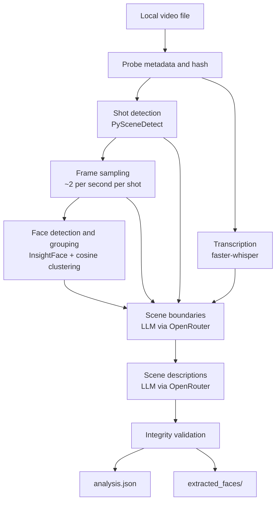

# Video Analysis: Shots, Scenes and Face Groups

Takes a YouTube video and produces:

- **Shots**: every camera cut, with start and end times.
- **Scenes**: runs of consecutive shots that share one time, place and action, each with a short description.
- **Face groups**: every detected face, clustered by visual similarity, with crops saved in one folder per group per scene.

Everything is driven from one notebook, [`notebooks/episode_analysis.ipynb`](notebooks/episode_analysis.ipynb). The reusable code lives in [`src/video_analysis/`](src/video_analysis/).

## Output

`outputs/analysis.json`:

```json
{
  "video_url": "https://www.youtube.com/watch?v=...",
  "shots": [
    {"id": 0, "start_seconds": 0.0, "end_seconds": 1.21},
    {"id": 1, "start_seconds": 1.21, "end_seconds": 5.297}
  ],
  "scenes": [
    {
      "id": 1,
      "start_seconds": 1.21,
      "end_seconds": 5.297,
      "description": "A young woman and a young man sit side by side on a leather couch in a dim, wood-panelled room.",
      "faces": {
        "group_001": ["00:00:01.960", "00:00:02.461", "00:00:02.961"],
        "group_002": ["00:00:01.960", "00:00:02.461"]
      }
    }
  ]
}
```

`faces` maps each face group seen in the scene to the timecodes (`HH:MM:SS.mmm`) of the sampled frames it appears in. The crops are saved under matching folders:

```text
outputs/extracted_faces/
├── scene_001/
│   ├── group_001/
│   │   ├── face_000_00-00-01.960.jpg
│   │   └── face_001_00-00-02.461.jpg
│   └── group_002/
└── scene_002/
```

Shot and scene `id`s are zero-based positions, and folder numbers use the same numbering. A group ID such as `group_001` means the same cluster across all scenes.

## How it works



1. **Probe** ([`media.probe`](src/video_analysis/media.py)) reads duration and resolution with PyAV and hashes the file. The hash keys every cache, so a different file never reuses old results.
2. **Shots** ([`media.detect_shots`](src/video_analysis/media.py)) decode every frame and run PySceneDetect's `AdaptiveDetector`. It flags a cut when a frame's change is much larger than the rolling average of its neighbours, which copes with camera motion better than a fixed threshold. Timestamps come from each frame's presentation time, so variable-frame-rate files stay accurate. The shots tile the video exactly, with no gaps or overlaps.
3. **Transcript** ([`media.transcribe`](src/video_analysis/media.py)) extracts 16 kHz mono audio with a bundled FFmpeg and runs faster-whisper on the CPU, filtering silence with voice-activity detection. Segment times are shifted back onto the source timeline. A video without an audio track produces an empty transcript and a warning.
4. **Frames and faces** ([`media.sample_shots`](src/video_analysis/media.py) and [`faces.FaceGrouper`](src/video_analysis/faces.py)):
   - Frames are sampled about twice per second inside each shot, starting half an interval in to avoid transition frames. Every shot gets at least one frame.
   - InsightFace's `buffalo_l` model detects faces and computes a 512-dimension ArcFace embedding for each. Faces below 40 px or 0.7 detector confidence are skipped.
   - Each face joins the existing group whose mean embedding is most similar (cosine similarity ≥ 0.48), or starts a new group.
5. **Scene boundaries** ([`scenes.SemanticAnalyzer`](src/video_analysis/scenes.py)):
   - Shots are sent to a vision-language model in windows of 8. Each window includes shot times, the face groups in each shot, the overlapping transcript lines, and one frame per shot.
   - For each adjacent pair of shots, the model answers whether a new scene starts between them, with a reason.
   - Windows overlap by one shot, so every boundary is decided exactly once, with both sides visible.
6. **Scene descriptions**: for each resulting scene, the model gets up to 12 frames spread across it plus its dialogue. It returns a description, a `kind` (story, opening, credits, montage, other), and a list of claims, each citing the evidence IDs it is based on.
7. **Validation** ([`validation.validate_analysis`](src/video_analysis/validation.py)) checks:
   - shots and scenes both tile the clip;
   - every shot is in exactly one scene;
   - every cited evidence ID exists and lies inside its scene;
   - every face box lies inside the frame and its shot;
   - every referenced image exists.
8. **Export** ([`export.export_assignment`](src/video_analysis/export.py)) writes `analysis.json` and rebuilds `extracted_faces/` from scratch. Crops from an earlier run never mix in.

### Design decisions

- **The model chooses; the code computes.** The LLM never produces a timestamp or an ID. Boundary answers may only use shot IDs from an `enum` in the JSON schema, and claims may only cite evidence IDs supplied in the request. Every answer is re-validated locally, and an invalid answer is retried, never accepted or cached. Scene times are therefore always exact shot boundaries.
- **Structured output via LangChain and the Responses API.** [`SemanticAnalyzer`](src/video_analysis/scenes.py) uses `langchain_openai.ChatOpenAI` pointed at OpenRouter with `use_responses_api=True`. It calls `with_structured_output(..., method="json_schema", strict=True)`. OpenRouter is told to route only to providers that support every requested feature (`require_parameters`).
- **Fail fast.** `preflight()` sends a tiny green image and expects `{"color": "green"}`. A model without image or strict-JSON support fails in seconds, not mid-run.
- **Caching and resumption.** Each local stage is cached in `cache/` under a hash of the video and only the settings that stage depends on. Changing the face threshold, for example, reuses the shots and transcript. Each accepted LLM answer is cached under a hash of the full request: model, prompt, evidence, images and schema. An interrupted run resumes where it stopped and never pays twice for the same answer.
- **Rate limits.** Free models reject back-to-back calls, so calls are spaced at least 10 s apart (`min_interval_s`; set 0 for paid models). An HTTP 429 is waited out with exponential back-off (10 s, 20 s, 40 s … up to 2 min, 6 times) and does not use up one of the 3 attempts reserved for invalid answers or provider errors. A hard `max_requests` budget caps billable calls, retries included.
- **Traceability.** Every LLM call appends one line to `cache/semantic/llm-traces.jsonl`. It records the run ID, call ID, stage, model, request fingerprint, evidence IDs, attempt, outcome, duration, error type or HTTP status, response ID and token usage. Prompts, transcript text, images and keys are never written. LangChain `run_name`, `tags` and `metadata` are attached too, so LangSmith tracing works if we enable it.
- **Anonymous face groups.** Faces are clustered, not recognised: no names, reference photos or identity claims. The prompt also tells the model not to identify real people from faces.

## Project structure

| Path | Responsibility |
|---|---|
| [`notebooks/episode_analysis.ipynb`](notebooks/episode_analysis.ipynb) | Configuration, run order, scene and face review, optional accuracy measurement, submission checks |
| [`src/video_analysis/schema.py`](src/video_analysis/schema.py) | Strict Pydantic models for every record; strict JSON read and atomic write |
| [`src/video_analysis/media.py`](src/video_analysis/media.py) | Probing, timestamp-accurate decoding, shot detection, frame sampling, transcription |
| [`src/video_analysis/faces.py`](src/video_analysis/faces.py) | `FaceGrouper`: face detection, embedding and online clustering |
| [`src/video_analysis/scenes.py`](src/video_analysis/scenes.py) | `SemanticAnalyzer`: LLM client, preflight, boundary and description requests, validation, cache, trace |
| [`src/video_analysis/pipeline.py`](src/video_analysis/pipeline.py) | `run_analysis`: stage orchestration and caching |
| [`src/video_analysis/validation.py`](src/video_analysis/validation.py) | Integrity checks on the final result |
| [`src/video_analysis/export.py`](src/video_analysis/export.py) | `analysis.json` and the `extracted_faces/` tree |
| [`src/video_analysis/evaluation.py`](src/video_analysis/evaluation.py) | Accuracy metrics against manual labels |
| [`tests/`](tests/) | Unit and integration tests using synthetic video and mocked models |

## Setup

Requires Python 3.11 or newer; tested on 3.11 and 3.14. `insightface` is built from source during installation, so a C++ compiler is needed:

- macOS: `xcode-select --install`
- Windows: Microsoft C++ Build Tools

```bash
python3 -m venv .venv
source .venv/bin/activate            # Windows: .venv\Scripts\activate
python -m pip install --upgrade pip
python -m pip install -e ".[dev]"
cp .env.example .env                 # then add your OpenRouter API key
```

`.env`:

```dotenv
OPENROUTER_API_KEY=sk-or-...
OPENROUTER_MODEL=openrouter/free
```

`openrouter/free` routes each request to a free model that supports images and strict JSON. For more consistent descriptions, use a fixed paid model such as `qwen/qwen3-vl-8b-instruct`. Any model must accept image input and JSON-schema structured output; the preflight checks this.

Place a local copy of the video at `data/input/episode.mp4` and set `YOUTUBE_URL` in the notebook's configuration cell. Only use a video you have the right to process; the project does not download from YouTube.

## Running

Open the notebook, select the `.venv` interpreter as the kernel, and run all cells. The first run downloads the InsightFace (~300 MB) and Whisper `small` (~500 MB) weights. On free models, rate limits can add waits between LLM calls.

Settings in the configuration cell:

| Setting | Default | Effect |
|---|---|---|
| `SAMPLE_FPS` | `2.0` | Frames sampled per second of each shot. Higher finds briefer face appearances but is slower. |
| `WHISPER_MODEL` | `"small"` | faster-whisper model size (`tiny` … `large-v3`). |
| `FACE_SIMILARITY` | `0.48` | Cosine similarity a face needs to join a group. Raise it if groups mix people; lower it if one person is split. |
| `MAX_API_REQUESTS` | `100` | Hard cap on LLM calls per run, retries included. A 4-minute video needs roughly 30–50 (one per 7 shots plus one per scene). |

The pipeline can also be used without the notebook:

```python
from pathlib import Path
from video_analysis.faces import FaceGrouper
from video_analysis.pipeline import run_analysis
from video_analysis.scenes import SemanticAnalyzer

analysis = run_analysis(
    Path("data/input/episode.mp4"), "https://www.youtube.com/watch?v=...",
    Path("outputs"), Path("cache"),
    FaceGrouper(), SemanticAnalyzer("openrouter/free", Path("cache/semantic")),
)
```

Besides `analysis.json` and `extracted_faces/`, the run writes `outputs/pipeline_result.json`. It holds the full validated result: every face with its box and score, transcript segments, sampled frames, scene kinds, settings, and each claim with its cited evidence.

## Testing

```bash
python -m pytest
```

The tests cover:

- shot detection and sampling on generated video;
- face grouping, filtering and cropping with a fake detector;
- LLM request windows, retries, schema enforcement, caching, budgets and tracing with a mocked chat model;
- every integrity check;
- the export format and folder layout;
- the accuracy metrics.

They need no network access or API key.

## Measuring accuracy

The integrity checks prove the output is consistent, not that it is correct. Section 8 of the notebook scores the results against hand labels:

- **Shots and scenes**: precision, recall and F1 of predicted cut or scene-start times against labelled ones, with optimal one-to-one matching within a tolerance (0.1 s for cuts, 1 s for scenes).
- **Face groups**:
  - *Purity* is the share of faces whose group's majority person is their own; it drops when people are merged.
  - *Inverse purity* is the share of faces whose person's majority group is their own; it drops when a person is split.

Use labels that were not used to tune `FACE_SIMILARITY`, and report how many items were labelled.

## Limitations

- Face groups are similarity clusters, not identities. One person can split across groups (profile vs. frontal, lighting, makeup), and look-alikes can merge. Children, heavy occlusion and very small faces are the weakest cases.
- Faces are only found in sampled frames, so appearances shorter than the sampling interval can be missed. The timecodes mark sampled frames, not continuous screen time.
- Scene boundaries and descriptions come from a model. They are least reliable for flashbacks, montages, and scene changes inside one continuous shot, where there is no cut to split on.
- `openrouter/free` may route requests to different underlying models, so the style of descriptions can vary between scenes.
- Frames and dialogue are sent to OpenRouter and its providers; face detection and transcription run locally.
- InsightFace's code is MIT-licensed, but its pretrained `buffalo_l` weights are for non-commercial research use only.

## Troubleshooting

| Symptom | Cause and fix |
|---|---|
| `SemanticError: ... is still rate-limited after 6 retries` | The free route stayed busy for several minutes, or its daily quota is used up. Wait and re-run the pipeline cell; completed answers are reused from the cache. Persistent limits are best solved with a paid model. |
| `SemanticError: ... failed after 3 attempts` | The model kept returning answers that fail validation. The error type of each attempt is in `cache/semantic/llm-traces.jsonl`; re-running usually succeeds, or switch to a stronger model. |
| `SemanticError` in the preflight with `OpenAIModelNotFoundError` | The model ID does not exist or is no longer free. Change `OPENROUTER_MODEL`. Details per attempt are in `cache/semantic/llm-traces.jsonl`. |
| `objc: Class AVFFrameReceiver is implemented in both ...` on macOS | PyAV and OpenCV each bundle FFmpeg's device library. The warning is harmless because neither library uses camera capture here. |
| `UserWarning: ... has no audio track` | The video file is video-only, which is common with separately downloaded YouTube streams. Scenes are then based on frames alone. Use a file with audio for better descriptions. |
| `insightface` fails to install | Install a C++ compiler (see Setup) and retry. |
